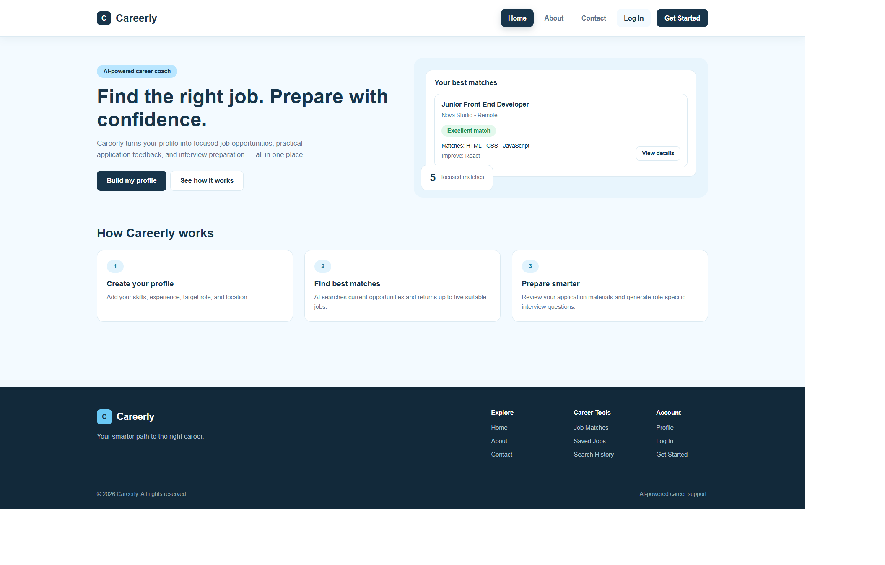
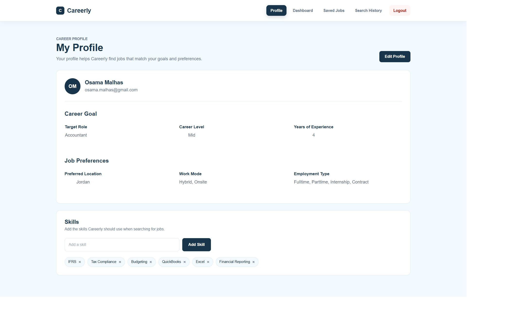
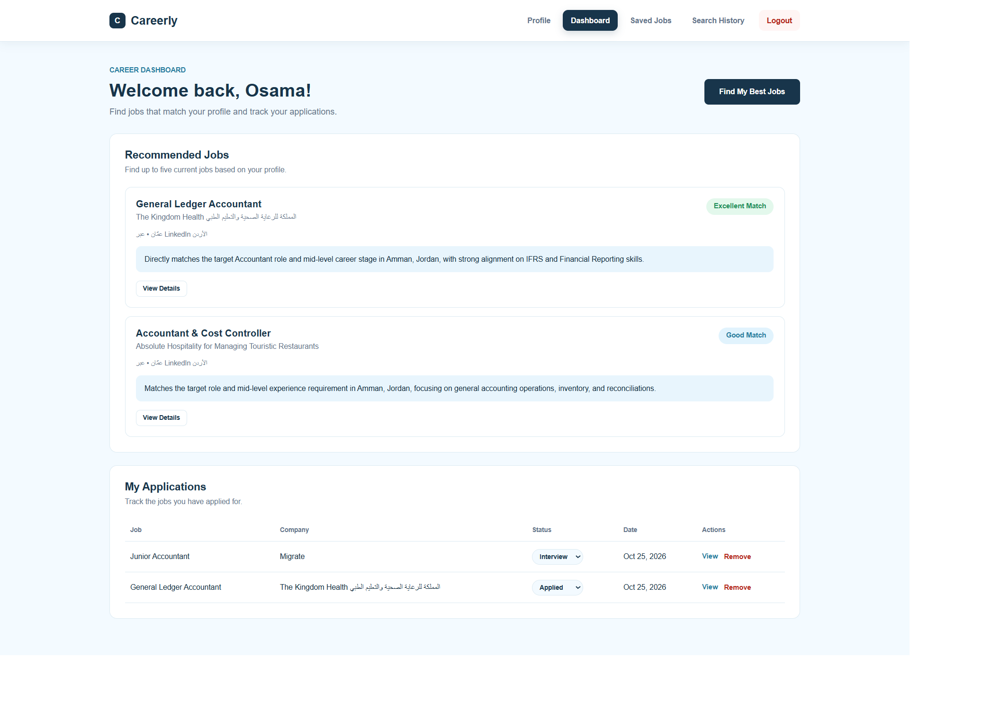
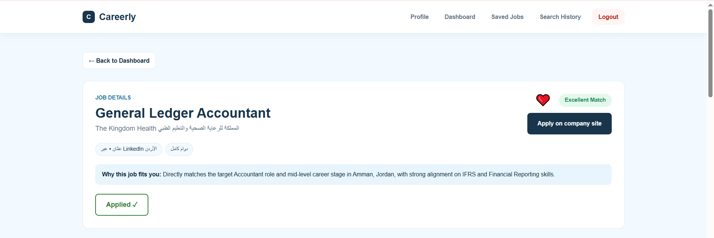
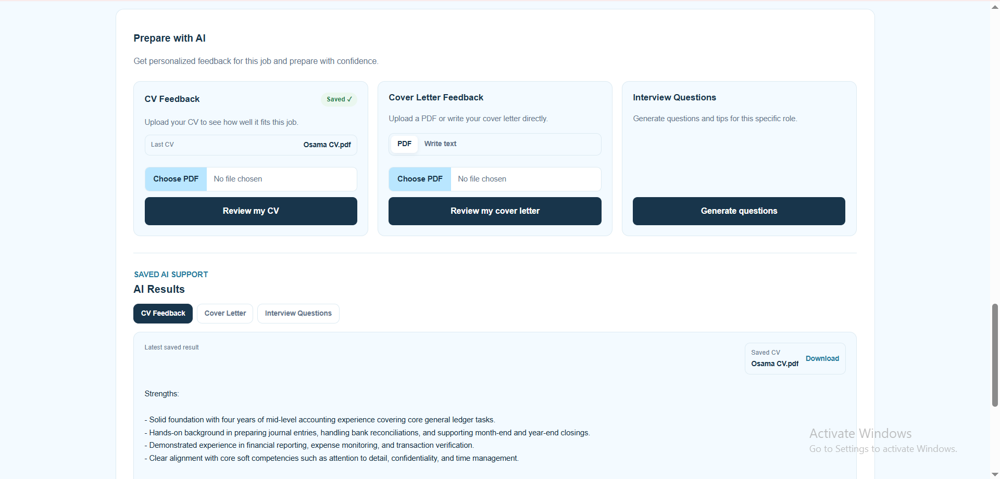
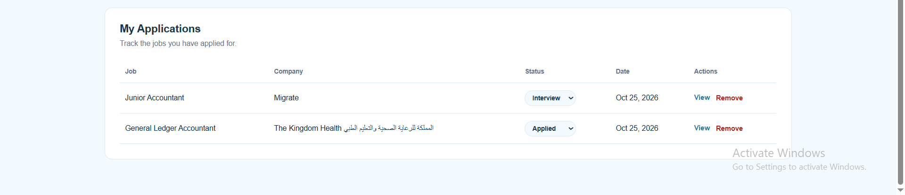
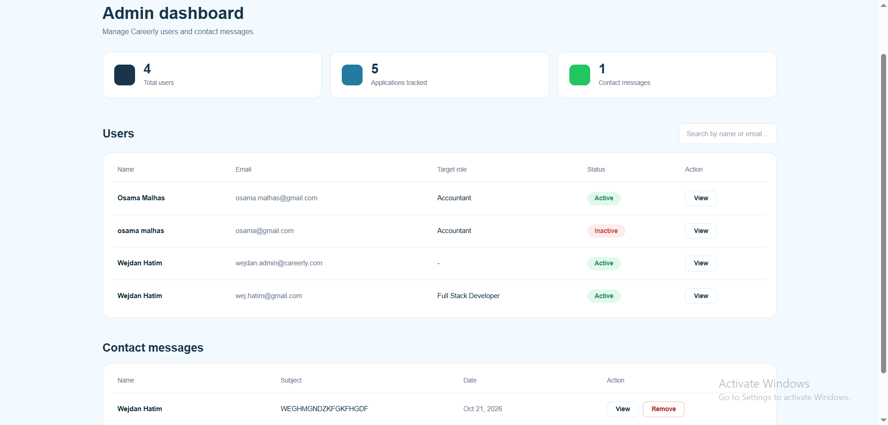

# 💼 Careerly

**Your AI career coach, from job search to interview.**

Careerly is a Django web app that works as a personal AI career coach. Job seekers build a career profile and get live job postings ranked by Google Gemini, with a reason for each match. It also reviews CVs and cover letters, generates interview questions, and tracks saved jobs and applications.

Built by **Wejdan Hatim** and **Khawla Qusay** as a group project for the **Axsos Academy Full-Stack Bootcamp** (October 2026).

🔗 **Live demo:** coming soon

---

## ✨ Features

### For job seekers
- **Career profile**: target role, level, experience, location, work mode and bio
- **Skills** added and removed instantly with AJAX
- **Find My Best Jobs**: up to 5 live jobs labeled *Excellent*, *Good* or *Possible* match
- **Job details** with *Apply on company site*, *I Applied* and a favourite toggle
- **Saved jobs** and **search history** to reopen past results
- **My Applications**: track each one as *Applied*, *Interview*, *Accepted* or *Rejected*

### AI tools
- **✨ CV feedback** from an uploaded PDF
- **Cover letter feedback** from a PDF or pasted text
- **Interview questions** for your target role
- **Saved AI results** in tabs, ready to open again

### For admins
- **Dashboard** with platform statistics
- Search users and **activate or deactivate** accounts
- View and delete **contact messages**

---

## 👥 Roles

| Role | Can do |
|------|--------|
| **User** | Build a profile, find jobs, use the AI tools, track applications |
| **Admin** | See statistics, manage user accounts and contact messages |

---

## 🛠️ Tech stack

| Part | Tools |
|------|-------|
| Backend | Python, Django, SQLite / MySQL, bcrypt |
| Frontend | HTML, Bootstrap 5, JavaScript (fetch) |
| AI | Google Gemini |
| Jobs API | JSearch (RapidAPI) |
| Deploy | AWS |
| Planning | GitHub, Trello, Figma |

---

## 🗄️ Database

9 models: `User`, `Profile`, `Skill`, `UserSkill`, `Application`, `Favorite`, `SearchHistory`, `ContactMessage`, `AIReview`.

- A user has one career profile
- Users and skills are linked many-to-many through `UserSkill`
- A user has many applications, favourites, search history entries and AI reviews
- Contact messages come from the public Contact page

---

## 🔒 Security

- Passwords are hashed with **bcrypt**
- Server-side **validation** on every form (custom model managers)
- **User and admin roles** with a custom session auth layer
- Only the owner can download an uploaded CV
- Secrets (API keys) are kept in a `.env` file, never on GitHub

---

## 📸 Screenshots

### Landing

### Profile

### Dashboard

### Job details

### ✨ AI results

### My Applications

### Admin dashboard

---

## 👩‍💻 Team

- **Wejdan Hatim**
- **Khawla Qusay**
